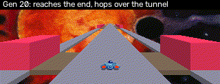
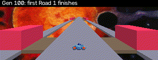
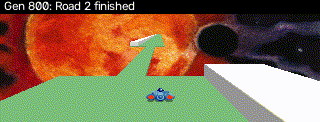
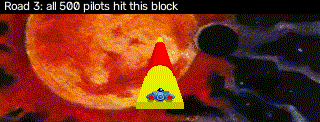
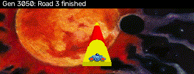
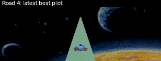
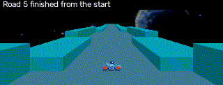

# Teaching a Neural Network to Play Skyroads with Evolution

Skyroads is a DOS game from 1993. You fly a ship down a road floating in space, and you steer, speed up, slow
down and jump over holes and blocks. Every road ends in a tunnel, and you have to drive into it to finish. I
wanted to see if an evolutionary algorithm could learn to play it, the same way SethBling's MarIO learned to play
Super Mario World. There is no gradient descent and no training on human play. The pilots that fly the furthest
get to breed, and mutation and crossover take care of the rest.

Claude Code wrote most of the code while I directed it, tested it and decided what to try next. This write-up goes through the approach, what went wrong, what fixed
it and where it stands now.

## Goal

The goal was to evolve one pilot that can finish Roads 1 to 3, and ideally all 30 roads. I set a few rules at the
start. Learning had to happen through evolution only, so selection, mutation and crossover. Shaping the task was
allowed, like adding inputs, practice starts and reward terms, but hand-coding the behaviour was not. The game would
run from my own copy without modifying it. Skyroads is freeware, but none of its files are in this repo. I also
decided not to recreate the real levels inside a custom simulator.

## The Pilot

Each pilot is a NEAT network, using the neat-python library. A network starts very small, with a few random links
from the inputs to the outputs and no hidden neurons. NEAT adds links and neurons over time as they help.

The pilot started with 165 inputs. Most of them are a grid of the road ahead: 13 lanes centred on the ship by 11
distance bands, covering every row up to 20 rows ahead. Each cell is a hole, road, tunnel or block. On top of that, the
pilot gets how far ahead each lane stays clear, its position and speed, its height above the road, the road's gravity,
and how close the end of the road is. Later in the project this grew to 222 inputs, which I go through further down.

There are 3 outputs: steer, throttle and jump. Steering is proportional, so the size of the output decides how often
the key is held down. This lets the pilot make small corrections on narrow parts of the road.

Each flight is scored as 1000 × progress + 500 × end approach + 1000 × finished. Progress only counts while the ship
is at road level, and it stops at 99% unless the road is actually finished. The end approach score is the share of
the last 5 rows that the ship spends on the ground in the tunnel's lane.

## Starting with a Simulator

I started with a simulator of our own called Starlane. It has similar mechanics to Skyroads, with 7 lanes, holes,
blocks, special tiles, fuel and oxygen, but its levels are randomly generated. A generation of 200 pilots flying 16
levels took about 3.5 seconds.

For a base case, I evolved a fixed network with a genetic algorithm and with an evolution strategy. I tested the
results on 40 easy levels that the pilots had never seen:

- Genetic algorithm - 12/40
- Evolution strategy, step 0.05 - 7/40
- Evolution strategy, step 0.02 - 8/40

Next, I switched to NEAT, which won 18 to 19 out of 40 with networks of about 19 links instead of 10,000 weights. It
was better, but every method stopped improving at about the same point. When I replayed the crashes, I found that the
pilots had learned to hold full throttle and jump all the time. Hopping clears holes and low blocks without any
effort, so it scores well, but it does not get the ship through walls. To steer into a gap, the network has to compare
its left and right side, and small mutations rarely find that.

The fix was to give the pilots better inputs. I added a clear path input for each lane, which says how far ahead that
lane stays clear. With these inputs, the best pilot went from 19/40 to 30/40, and it was the first pilot to move up the
difficulty levels. Since all three algorithms got stuck at the same score, the problem was what the pilots could see,
not the algorithm.

## Moving to the Real Game

When I tried the simulator pilot on the real game in DOSBox, it lasted about 6 seconds on Road 1. The physics were
different, reading the road from screen colours only worked on one road, and a ship inside a tunnel looked the same as
a crash. So I moved the training onto the real game itself, running 6, then 12, then 18 DOSBox windows at the same time.

MarIO read the game's memory to get its inputs, so I did the same. The trainer reads the running game's memory, without
writing to it, to get the ship's position, height, speed and the road cells ahead. This gave exact falls, crashes and
finishes. While watching it, I noticed that every road ends in a tunnel, and the ship has to drive into it at road level
to finish. Pilots flying off the end of the road had been counted as wins. Entering the tunnel sets the ship's height
straight to 0, while a fall sinks slowly, so that became the finish signal. I also noticed that some roads have different
gravity, so each road now gets one standing jump to measure it, and gravity became an input.

The hopping habit came along from the simulator. In the replays, the jump key was held down the whole way over the final
tunnel. A small penalty for jumping, along with the end approach reward, brought the time spent jumping down from 88% to
about 13%. I later removed the penalty, because jumping is fine everywhere except the end of the road.

The next problem was that pilots did not reach the end often enough to learn it. To fix this, I added practice flights.
The best pilot flies the road, and each new pilot takes over 12 rows before the end. Within 5 generations, 4 out of 40
pilots were finishing the road for real. The first pilot to finish a whole road on its own came at generation 107.
Roads 2 and 3 were still stuck at 18% and 25%, so I moved the takeover point to just before wherever the furthest pilot
got stuck. That way, practice always happens at the spot the population needs to learn next.

There were other issues along the way. The lane mapping was off by almost half a lane, so pilots were wrong about which
lane they were in about half the time. After fixing it, tunnel entries went from about 45 to about 250 per generation.
Results were also noisy, and the same pilot could finish one flight and crash the next. Syncing the pilot's decisions to
the game's own updates helped, but real time play stayed noisy, and with only 40 pilots, selection was partly luck.

It was also slow. Faster screen capture, one process per window, DOSBox fast forward and shorter menu waits brought a
generation from about 240 seconds down to about 85, which is still only about 42 generations an hour. Road 1 was
finished many times. Road 2 was finished once in a practice flight, and it showed up as completed in the game's road
menu. Neither was reliable.

## A Simulator Matched to the Game

With access to the game's memory, I could measure the real physics and build a simulator that matched them. Top speed
was 6.03 rows per second in both, it took 4.10 seconds to reach top speed in the game and 4.07 in the simulator, and the
jump height and time in the air matched as well. This simulator used its own generated roads and trained about 60 times
faster.

However, the pilots trained in it did not do well on the real game. The best one reached 54% of Road 1 and never
finished it. Varying the physics, adding harder practice courses and swapping pilots between the simulator and the real
game did not close the gap. Small differences in collisions, tile edges and timing all mattered, and matching them by
hand did not have an end.

## Using an Open Source Port

Eventually, I found skyroads-sdl (https://github.com/pedrocatalao/skyroads-sdl), an open source port that runs the
game's own freeware data with a rewrite of its game logic. I cloned it without changes and wrote a small C driver,
`ext/skyenv/sky_env.c`, that runs the game loop without a window. Once per frame, it sends the ship's state to Python and
gets back the keys to press.

A full flight takes about 20 milliseconds, compared to about 10 seconds in DOSBox. That is roughly 500 to 1000 times
faster, with the game's own physics and finish rule. I checked the port against DOSBox for speed, jump height and lane
positions, and I set up a viewer that flies the same pilot in both games side by side.

## Training in the Port

In the port, each generation has 500 pilots. Each pilot flies every unlocked road once, along with practice flights
that start along each road and near its end. Fitness ranks each road and practice point separately, and then combines
them as 0.6 × the average + 0.4 × the worst road + 0.25 × the practice average. Training starts on Road 1 only. The next
road unlocks when half of the top 20 pilots finish every unlocked road for 5 generations in a row, and roads that are
already learned give a bonus for finishing them.

At first, I started the port training from the pilots trained in DOSBox. After 170 generations, Road 1 was only finished
in 1 to 4 out of 400 flights, so I restarted from scratch. The new population reached 83% of Road 1 within 40 seconds.

The next problem was jumping. About 88% of pilots held the jump key down, which gets through most of Road 1 but bounces
over the final tunnel. Less is more, and sometimes just continuing with the momentum is good enough. A tap to jump mode
taught them that, and that run learned Road 1, including real finishes in DOSBox. However, it also made jumping itself
hard to learn. Once I stopped caring about matching the DOSBox timing exactly, I went back to the game's own held jump,
exact timing and a decision every frame, and the pilots learned much faster.

At generation 20, the best pilot already reached the end of Road 1, but it hopped over the final tunnel
and fell. By generation 100, pilots were driving into the tunnel and finishing the road.

Adding Road 2 caused the pilots to forget Road 1, and finishes dropped from about 400 to about 10 over 38 generations. A
bonus for finishing old roads fixed this. When the bonus was 5000, it blocked pilots that were making progress on Road 2.
At 600, losing Road 1 completely costs more than anything Road 2 can give, but one missed finish can still be made up.

From generation 774 to 1409, about 4 out of 500 pilots finished Road 2 every generation, but that number never grew,
and at generation 1410 the last of them died out. There were two reasons for this. With ranked fitness, finishing the
road only ranked one place above falling off at 99%. Also, the practice flights were carried by the furthest pilot of the
current generation, so when the finishers died out, the practice at the end of Road 2 went away with them. I rolled back
to generation 1100, added a bonus of 400 for finishing the newest road, and kept the furthest pilot ever for practice.
After that, the finishers survived, but there were still only 4 or 5 of them.

To find out why, I took the 4 pilots that finished both roads, bred 60 children from each, and flew them. The results
were:

- Default NEAT mutation, which changes 80% of the weights - 8% still finished both roads
- Crossover with another pilot and default mutation - 2%
- Gentle mutation, which changes 10% of the weights by small amounts - 96%
- Crossover with another pilot and gentle mutation - 29%
- Crossover between two finishers and gentle mutation - 45%

As observed in the results above, the finishers were surviving, but almost none of their children kept the skill. I
switched to gentle mutation and bred 75% of the children from a single parent. Road 2 finishers went from 6 to 79 within
5 generations, and Road 3 unlocked at generation 1265. Later, about 470 out of 500 pilots were finishing Road 2.

Gentle mutation also made the pilots almost identical to each other. All 500 of them hit the same block early on Road 3,
at row 10 or about 12%, for 155 generations.

The pilot jumps the gap fine, but it keeps steering while in the air and drifts into the block on the side.
To bring back variety, I added explorers, which are 20% of the children
mutated with the old, stronger settings. One of them got past the block right away, but it had lost Roads 1 and 2 along
the way, so it ranked near the bottom and died out. The explorers also created a lot of species, from 2 to 105, and NEAT
does not merge species on its own, so the trainer now sorts everyone into species again when the count gets too high.

To keep pilots like that explorer alive, I added protected seeds. The 5 pilots that get the furthest on the newest road
are kept every generation, even if they fail the older roads, along with 25 children bred from them with gentle
mutation. Road 3 went from 27% to 86% in 4 generations, and the seeds slowly won back Road 1 and most of Road 2.

Then the pilots hit another wall at row 52 of 60. The left lane ends at row 49, and the only way forward is to jump right
onto a few short lanes in the middle, and then jump again onto a strip on the far right. A pilot that makes the first jump
and then falls scores the same as a pilot that rides straight off the end, so the pilots that were halfway there kept
getting thrown out. Nothing changed for 240 generations.

To fix this, I used stepping stones, which is the idea behind MAP-Elites. Every flight records the last spot the ship
stood on, by row and lane. Each spot keeps the best pilot that got there, and the furthest spot in each lane is planted
back into the population every generation. A pilot that reaches the middle lanes and then falls is now kept, and its
children only have to learn the second jump. Within 70 generations, the stepping stone in lane 2 moved from row 44 to row
49, and pilots reached the right side of the road for the first time. However, after another 100 generations, no pilot
had landed on the middle lanes.

## Is the Crossing Even Possible?

Before changing anything else, I wanted to know if the crossing could be done at all. I took a pilot that rides the left
lane, let it fly to row 40, and then took over with scripted key presses. I tried every combination of jump timing,
steering and throttle. Out of 10,512 attempts, 4,212 finished Road 3. The move is to jump at about row 43 while steering
right, land on the middle lanes around row 46, and then jump again steering hard right onto the far right strip. The
timing is forgiving, so the problem was not the game or the physics. Evolution just could not find it.

Next, I added two practice starts past the crossing, one on the middle lanes at row 47 and one over the far right strip
at row 50. A scripted run up takes the ship there, and the pilot flies by itself from that point. This only decides
where practice starts, so the pilots still learn everything through evolution. Interestingly, the best pilot already
finished Road 3 from both of these starts. It knew how to do the second jump and enter the tunnel. The only thing it was
missing was the first jump. I also cut the explorers down to 10%, because Roads 1 and 2 were slipping.

## The Inputs Were Pointing the Wrong Way

Even with the practice starts, no pilot made the first jump. Looking at the inputs at row 43 explained why. The clear
path inputs treat a hole as blocked right away. At row 43, the middle lanes start with 3 rows of holes, so they read as
blocked, while the left lane reads as clear for 6 more rows. The pilots were following their inputs straight into the
dead end. Even the far right strip, which is the only way to the end, reads as blocked because it is made of low blocks.

I made the clear path jump aware. A hole of up to 3 rows counts as passable if road follows it, and low blocks count as
platforms to land on. With this, the far right strip reads as the longest clear path at row 43. My first version
replaced the old inputs, but that confused the existing pilots. In a test of 150 pilots, Road 1 finishes dropped from 43
to 16 and Road 2 from 24 to 1. So I added the jump aware version as 15 new inputs instead, and kept the old ones as they
were. The new inputs start with zero weights, so nothing changes until evolution starts using them.

The new inputs also slowed training down, from about 35 to about 55 seconds per generation. Profiling showed that about
three quarters of the time went into building the inputs on every frame. The road ahead only changes when the ship moves
to a new row or lane, so I cached that part. Generations went down to about 13.5 seconds, about 4 times faster than
before, with exactly the same results.

## Breaking Through Road 3

About 50 generations after the new inputs and the speed up, a pilot made the crossing on a full flight by itself and
reached 94% of Road 3. The stepping stones kept it, and its line slowly won back Roads 1 and 2. At generation 2428, the
best overall pilot went from 12% to 86% of Road 3 while still finishing Roads 1 and 2. At generation 2569, pilots started
finishing Road 3 on full flights, about 70 of them every generation.

However, Road 2 started falling apart. Road 2 finishers dropped from about 150 to 9 per generation, and the best pilot
was giving up Road 2 to finish Road 3. This was a mistake in my bonus for old roads. The bonus was 600 times the average
share of old roads finished. With only Road 1 as an old road, losing it cost the full 600. With two old roads, losing
Road 2 only cost 300, which is less than the 400 bonus for finishing the newest road. So dropping Road 2 for Road 3 was a
good trade for the pilots. I changed the bonus to 600 for each old road, so losing Road 2 costs more than finishing Road 3
gives.

After that, the pieces came together. At generation 3049, the first pilot finished Roads 1, 2 and 3. Within 5
generations, more than half of the top 20 pilots were finishing all three every time, and Road 4 unlocked at generation
3055. Road 4 went much faster than Road 3. A pilot reached its end in the very first generation, and pilots have
finished it in every generation since.

At generation 3110, the top pilots were finishing all four roads, and Road 5 unlocked at generation 3149.

## Road 5 and Checking Every Input

On Road 5, the furthest pilot got to 91% and stayed there. The best pilot overall only reached 38%.
I replayed the pilots and found two places where they were going wrong.

The first was around row 50. The pilots were riding on top of a row of low blocks in lane 1, which works for a while,
and then they hit a tall block. When I scripted a jump from the low blocks onto the tall block, the ship got past it and
through a wall at row 55 in 304 out of 768 tries, but those runs crashed again around row 64. The second was around row
114. The pilots were driving through a row of arches in lane 5 and then jumping off the road at row 111. In a scripted
test, simply staying in lane 5 finished Road 5 in 3 out of 3 tries. So the pilots were close, but they did not
understand what they were looking at.

At this point I went through every tile and object in the port's game code and tested each one on short test roads
written into the port's memory, without touching the game files. This turned up a few things my inputs had wrong.
Arches can be driven under, but my inputs counted them as blocked. Tunnels can be driven through, and their roof is
curved, so a ship that lands on the roof off centre slides off, while an arch has a flat roof. A tunnel can also lead
into a wall or a hole, so going in does not mean coming out. Blocks come in two heights. A tall block cannot be jumped
onto from the road, but it can be reached from the top of a low block. The special tiles also checked out. The speed
tile takes the ship to top speed, the brake tile slows it down until it stops, the slippery tile stops it from
steering, the supplies tile refills fuel and oxygen, and the fire tile explodes it, even on top of a block. Hitting a
wall at low speed is only a bump. At top speed, the ship clears a gap of 1 or 2 rows easily, 3 rows only if it jumps
from the very last part of the road, and 4 rows not at all.

My first try fixed the old inputs in place, and it broke the pilots again. Every one of the 13 pilots that finished Roads 1 to 4 failed
after the change. So I did the same thing as with the jump aware inputs and added the corrected version as new inputs
next to the old ones. The pilots now also get the special tiles ahead in the 5 nearest lanes, what the ship is standing
on (the road, a block top, a tunnel roof, a slippery tile or a brake tile), and how much fuel and oxygen is left. In
total this took the inputs from 180 to 222, and every new input starts with zero weight.

For a long time nothing changed. Then, about 340 generations after the new inputs were added, at generation 3742, a
pilot finished Road 5 from the start for the first time. Since then, 1 to 4 pilots have finished it in almost every
generation. Road 4 also got stronger, from about 7 finishers per generation to between 15 and 43.

However, none of the pilots that finish Road 5 also finish the older roads. The pilot in the recording above finishes
Road 5 and reaches 99% of Road 1, but it only reaches 2% of Road 2. Road 5 is now a matter of combining two groups of
pilots, the ones that keep the old roads and the ones that know Road 5.

## Where It Stands

At generation 4371, the pilots have passed the goal I set at the start, which was one pilot that finishes Roads 1, 2
and 3. The best pilot finishes Roads 1 to 4 and reaches 38% of Road 5, and a few other pilots finish Road 5 on their
own. Road 6 will unlock once half of the top 20 pilots finish all five roads. Road 2 is the weakest of the learned roads,
with only 2 to 8 finishers per generation, and Road 3 has dropped from about 40 to between 8 and 24. A generation of 500
pilots, each flying 35 times, takes about 30 seconds.

All of the recordings above are made with `record_progress.py`, which picks a pilot from a checkpoint or the training
state and flies it in the port with its own renderer.

## Conclusion

To summarize, the environment made the biggest difference. DOSBox in real time gave about 40 noisy generations an hour,
while the port gives exact, repeatable flights about 1000 times faster. Fixes that took hours to test in DOSBox took
minutes in the port. After that, almost every problem was in how the pilots were bred and scored, not in the pilots
themselves.

Some lessons from this project:

- Get the exact game state and a correct finish signal first. Reading the screen and guessing gave false wins and hid
  the real problems.
- Do not build your own simulator of a game you can already run. The matched simulator hit every number I measured and
  still did not work on the real game.
- If every algorithm gets stuck at the same score, look at the inputs.
- Ranked fitness hides big jumps like finishing a road, so finishing needs its own bonus.
- Test mutation directly. Breeding children from a good pilot and flying them explained hundreds of stuck generations in
  a few minutes.
- Keep a balance between keeping skills and exploring. Gentle mutation keeps skills but makes every pilot the same, and
  strong mutation explores but breaks skills.
- Scoring by distance alone does not work well when an obstacle takes more than one move. Protected seeds and stepping
  stones keep the pilots that are halfway there.
- Start practice where the population gets stuck, and leave enough room before the obstacle.
- When the pilots are stuck, check if the move is possible at all. A scripted test answered that in a few minutes.
- Check what the inputs are telling the pilots at the stuck spot. Mine were pointing them into a dead end.
- Test every tile and object in the game against what the inputs say. Mine had arches as walls for most of the project.
- Add new inputs next to the old ones instead of fixing them in place. Changing an input that trained pilots rely on
  breaks them, even when the change is correct.
- Be careful with bonuses that are averaged. A bonus that worked for one road got weaker as more roads were added.
- Profile before guessing. My first guess at the slowdown was wrong, and caching the right part made training 4 times
  faster.
- Save checkpoints often. Being able to roll back saved the run more than once.

Next, I want to let it keep going through Road 5 and beyond, and see how far one pilot can get. I also want to try
breeding the Road 5 finishers with the pilots that already finish the old roads, since two finishers bred together kept
the skill 45% of the time. Other ideas are separate pilots for each road that can help when the main run gets stuck, turning the
DOSBox timing back on once the roads are learned, and novelty search for the hardest spots.

There are some limitations. One pilot has to remember every earlier road while it learns the next one, and the bonuses
and seeds that make this work were tuned by hand. The scripted run ups on Road 3 are also my own design, even though they
only decide where practice starts. Training in the port no longer matches the DOSBox timing, so results
on the real game are mixed. Roads 6 to 30 have not been tried yet, and Road 20 has so much gravity that jumping is not
possible. The pilots now see their fuel and oxygen, but in recent generations no flight has run out of either, so
that part is untested.

## Repo Layout

- `starlane/` - the Starlane simulator, the shared inputs (`realobs.py`), the matched simulator, and the port wrapper
  (`portenv.py`)
- `bridge/` - DOSBox window control, screen capture, memory reading and live flying
- `ext/skyenv/` - the C driver that runs the skyroads-sdl port without a window
- `train.py`, `train_neat.py` - training in Starlane
- `train_real.py`, `train_realsim.py` - training in DOSBox and in the matched simulator
- `train_port.py`, `train_forever.ps1` - training in the port, and a script that restarts it if it crashes
- `watch_side_by_side.py`, `check_transfer.py` - the side by side viewer, and an hourly check on the real game
- `record_progress.py` - records the GIFs in `docs/media/` from training checkpoints
